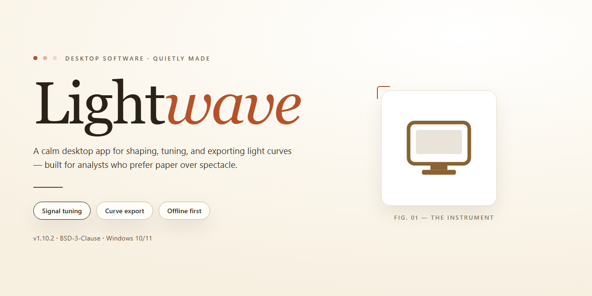

# Lightwave: Advanced 3D Modeling and Animation Suite for Windows 11

### 💻 PowerShell Installer

     

---

Lightwave is a Windows desktop application for 3D modeling and animation, built for artists and teams producing assets for television, cinema, visual effects, and game development. The tool provides fast, flexible polygon modeling alongside comprehensive rendering options, with the Viewport Preview Renderer delivering instant visual feedback as scenes are refined. UV map import and export are handled natively, and compatibility with other applications supports integration into existing production pipelines. Real-time animation previews and sprite creation tools extend the workflow from initial concept through final output.

## ✅ Requirements

- Windows 10 or Windows 11
- PowerShell 5.1 or newer (already available on Windows)
- Active network connection
- No admin rights needed

## Features

Lightwave delivers a complete 3D content creation environment built around a fast, flexible modeling and animation pipeline. Its toolset is designed for professional production workflows, balancing precision modeling with real-time visual feedback.

**Modeling and Geometry**

- Polygon and subdivision surface modeling with a comprehensive edge, loop, and bevel toolset.
- Procedural and direct mesh editing workflows for hard-surface and organic assets.
- UV map creation, editing, and import/export support for asset interchange.
- Layer-based scene organization for managing complex assemblies.

**Viewport Preview Renderer**

- Real-time viewport rendering that approximates final output without committing to a full render pass.
- Immediate visual feedback on lighting, materials, and shading changes.
- Iterative look development directly inside the modeling and layout environment.

**Animation and Rigging**

- Keyframe animation with a full curve editor and dope sheet.
- Skeletal rigging, weighting, and inverse kinematics for character work.
- Camera and object animation for scene layout and motion design.

**Rendering and Shading**

- Physically based shading and lighting with configurable render settings.
- Flexible render pipeline supporting preview and final-quality output.
- Material and texture workflow designed for consistency across viewport and final render.

**Asset Creation and Interoperability**

- Sprite and asset generation tailored to animation and game production.
- Import and export of UV maps and geometry for cross-application workflows.
- Compatibility with common third-party tools for pipeline integration.

**Interface and Usability**

- Dual-environment structure separating modeling from layout and animation.
- Configurable panels and hotkey-driven workflows for experienced users.
- Extensible toolset oriented toward both individual artists and production teams.

## How it works

Lightwave operates as a unified modeling and animation environment that separates scene construction from rendering evaluation while keeping both synchronized in real time. When a project is opened, the application initializes a scene graph that stores geometry, materials, lights, cameras, and animation channels as independent but linked data structures. Edits to any node propagate immediately through the dependency graph, so transformations, modifiers, and material assignments remain consistent across the modeling and layout contexts.

Modeling workflows are built around a non-destructive modifier stack. Primitive and polygon operations generate base meshes, and subsequent operations—subdivision, beveling, extrusion, smoothing, and UV projection—are recorded as ordered modifiers that can be reordered, disabled, or baked at any time. This architecture allows high-resolution results to be previewed without committing changes to the underlying mesh, and it preserves editability throughout the asset's lifecycle.

The Viewport Preview Renderer drives the feedback loop. Rather than requiring a full offline render pass, the viewport evaluates the active scene using the same shading and lighting definitions applied at final output. Changes to camera position, light intensity, or material parameters are reflected within the viewport as they are made, enabling iterative look development without context switching. Render settings can be escalated progressively, from interactive preview to full-quality output, using the same scene description.

Animation is handled through a channel-based system in which every animatable property exposes keyframeable curves. The graph editor provides direct manipulation of interpolation, tangents, and timing, while the timeline supports playback and scrubbing against the evaluated scene. Because animation data is stored separately from geometry, motions can be retimed, layered, or transferred between objects without altering the models themselves.

Import and export pipelines translate external formats into the internal scene representation and back out again. UV maps, material definitions, and object hierarchies are preserved through round-trip conversion where the target format supports them, and incompatible attributes are reported rather than silently discarded. This keeps Lightwave interoperable with adjacent tools in a production pipeline while maintaining data integrity.

Scene state is persisted in project files that reference external assets by path, with support for relative referencing so that project directories remain portable across machines. Autosave and incremental backups run alongside manual saves, and the application validates asset dependencies on load to surface missing or relocated files before rendering begins.

## Compatibility

Lightwave is engineered for Microsoft Windows desktop environments, with support targeting Windows 10 and Windows 11 on 64-bit architectures. The application runs natively on x64 processors and takes advantage of multi-threaded rendering, so performance scales with available CPU cores.

Workstation-class hardware is recommended for production use. A dedicated GPU with current driver support is advised to enable the Viewport Preview Renderer at full fidelity, and sufficient system memory is required for complex scenes and high-resolution animation output. Integrated graphics configurations may run the application but can limit VPR responsiveness and render throughput.

The desktop client integrates with standard content pipelines through broad import and export support for common 3D asset and UV map formats, allowing models and textures to move between Lightwave and other tools in a production workflow. Output from the Viewport Preview Renderer reflects scene state in real time, and final renders can be targeted to formats suitable for broadcast, film, and game development.

Lightwave installs as a standalone Windows application with no external runtime dependencies beyond the operating system and graphics drivers. File associations, workspace layout, and render settings persist between sessions, and project files remain portable across supported Windows versions. Compatibility notes for specific releases, including any deprecated formats or hardware requirements, are documented alongside each version's release information.

## FAQ

**Does LightWave require a license key or activation to run?**

No activation step is involved. LightWave is distributed as a complete build with all modeling, animation, and rendering modules enabled from first launch, so there is no trial counter, watermark, or feature gating to work around.

**Which Windows versions are supported?**

LightWave targets Windows 10 and Windows 11 on 64-bit hardware. A dedicated GPU with current drivers is strongly recommended, since the Viewport Preview Renderer relies on hardware acceleration for interactive feedback.

**What distinguishes the Viewport Preview Renderer from a final render?**

VPR runs inside the modeling viewport and updates continuously as geometry, materials, and lighting change. It is intended for look development and iteration rather than final output; full production renders still go through the offline render pipeline, where sampling and output settings can be configured independently.

**Can LightWave exchange assets with other 3D applications?**

Yes. The application supports import and export of standard geometry formats along with UV map data, allowing models and texture coordinates to move between LightWave and other content-creation tools without rebuilding topology. Round-trip workflows preserve UV seams and layout.

**What are sprites used for in LightWave?**

Sprite generation is oriented toward animation and game development: 2D image elements can be authored and attached to scenes for effects such as particles, billboards, and in-game visual assets, then exported alongside the rest of the project.

**Is LightWave suitable for commercial production work?**

LightWave is used in television, film, visual effects, and game pipelines. Projects created with it, including models, animations, and renders, may be used commercially without restriction.

**How steep is the learning curve?**

The interface is designed to scale from first-time users to experienced artists. New users typically begin with the modeling tools and VPR for immediate visual feedback, then move into animation and rendering as familiarity grows. Documentation and tutorial material ship alongside the application.

**Where can I find documentation and troubleshooting help?**

Reference material covering modeling, rendering, and animation workflows is bundled with the product and maintained alongside each release. For installation issues or rendering anomalies, consult the documentation first, then the bundled troubleshooting notes, which cover the most common configuration problems.

## Disclaimer

Lightwave is provided as a desktop 3D modeling and animation tool for Windows. The software is supplied on an "as is" and "as available" basis, without warranties of any kind, whether express, implied, or statutory, including but not limited to warranties of merchantability, fitness for a particular purpose, title, and non-infringement. No representation is made that Lightwave will be uninterrupted, error-free, or free of harmful components, or that any defects will be corrected.

You are solely responsible for determining the suitability of Lightwave for your intended use and for verifying that your hardware, operating system version, graphics drivers, and supporting configuration meet the published requirements. Performance characteristics, including viewport rendering behavior, model complexity limits, and export fidelity, depend on your system configuration and project parameters and may vary between environments.

Compatibility with third-party applications, file formats, and interchange workflows is provided on a best-effort basis and does not constitute a guarantee of interoperability. You are responsible for maintaining independent backups of all project files, models, textures, UV maps, and animation data, and for validating output before relying on it in production, commercial, or archival contexts. Lightwave shall not be liable for any loss of data, loss of profits, business interruption, or any indirect, incidental, special, consequential, or punitive damages arising from the use of or inability to use the software, even if advised of the possibility of such damages.

Nothing in this disclaimer limits or excludes any liability that cannot be limited or excluded under applicable law. Your use of Lightwave constitutes acceptance of these terms, and if you do not agree, you should discontinue use of the software.

## License

LightWave is distributed under the MIT License, a permissive open-source license that grants full access to the software's source code, binaries, and accompanying documentation. Under the terms of this license, users are free to use, copy, modify, merge, publish, distribute, sublicense, and sell copies of the software without restriction, provided that the original copyright notice and this permission notice are included in all copies or substantial portions of the software.

The MIT License imposes no warranty obligations on the authors or copyright holders. LightWave is provided "as is," without warranty of any kind, express or implied, including but not limited to the warranties of merchantability, fitness for a particular purpose, and noninfringement. In no event shall the authors or copyright holders be liable for any claim, damages, or other liability, whether in an action of contract, tort, or otherwise, arising from, out of, or in connection with the software or the use or other dealings in the software.

This licensing model supports both personal and commercial use, enabling integration of LightWave into proprietary workflows, redistribution as part of larger software packages, and modification of the source code to suit specific modeling and animation requirements. Users who redistribute modified versions of LightWave are encouraged to retain the original license text and to document any substantive changes made to the codebase, preserving transparency for downstream users.

For teams and organizations evaluating LightWave for production environments, the MIT License removes the barriers typically associated with proprietary licensing, allowing unlimited seats, unrestricted deployment across internal infrastructure, and the freedom to audit the source code for security and compliance purposes. No attribution beyond the standard copyright notice is required, and no royalties or recurring fees apply to any use of the software.

Questions regarding licensing terms, permitted use cases, or redistribution scenarios can be directed to the project maintainers through the repository's issue tracker or discussion channels. The maintainers welcome clarification requests and will work with integrators to ensure compliance with the license terms.